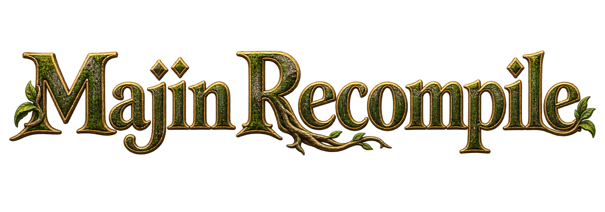

  

  An unofficial Windows recompilation of <strong>Majin and the Forsaken Kingdom (Xbox 360)</strong>. 
  Windows x64 · Direct3D 12 · European/PAL revision · Experimental community alpha

Majin Recompile uses **ReXGlue SDK 0.10.0 and its Xenia-derived runtime** to run recompiled game code on PC. This is a community project, unaffiliated with the original developers or publisher.

**No ISO, original game assets, DLC, saves, shader caches or generated game C++ are distributed in the repository or source companion. You must provide the files from your own legally acquired, supported copy of the game.**

**The European/PAL Xbox 360 ISO was used for testing. American/USA and Japanese editions have not been tested.** Acceptance depends on the executable revision, not the ISO filename.

This is the clean public source publication; the previous development history remains private. See [PUBLICATION.md](PUBLICATION.md).

## Download and play

Download [**v0.1.0-alpha.3 — Windows x64**](https://github.com/GM-0856/majin-recompile/releases/tag/v0.1.0-alpha.3). Choose **Majin-Recompile-v0.1.0-alpha.3-Windows-x64.zip** to play. Developers should also download the matching **Sources.zip**, which includes the patched SDK and pinned dependencies; GitHub's automatic source ZIP contains only this project.

1. Extract the entire Windows ZIP to a **short, writable folder on your local SSD**, such as `C:\Games\Majin`.
2. Double-click **Majin FK Launcher.exe**. No manual terminal commands are needed; the Windows launcher currently uses PowerShell internally.
3. Choose **Import ISO** for your own uncompressed supported Xbox 360 ISO, or **Browse** to extracted data containing `default.xex` and `finalizedXBox360`.
4. Start with **1x Native (720p)**, **Original** frame rate and **Default** rendering. Use **ROV Compatibility** if Default loses the image, as observed on the tested Ryzen 5 5500U.
5. Select **Controller** or **Keyboard + mouse (test)** and click **Play**. For the optional timing patch, select **60 FPS (test)**. **Esc** opens the quit confirmation; **Enter** opens the in-game pause menu in keyboard mode.

If a Microsoft runtime DLL is missing, install the [Microsoft Visual C++ x64 Redistributable](https://learn.microsoft.com/en-us/cpp/windows/latest-supported-vc-redist). Windows x64/D3D12 is the current release platform. Linux/Vulkan is planned.

Alpha.3 refreshes the launcher background with the owner-supplied scenery-only image. The game, GPU and audio binaries are the same ones tested for Alpha.2.

## Features and current limits

- **Original / 60 FPS (test):** an opt-in 60-FPS cap and timing changes, with Original retained as the default. Prerecorded movies keep their original cadence. This is not frame interpolation or a universal 60-FPS guarantee.
- **Default / ROV Compatibility:** separate rendering choices and persistent shader caches. ROV restored missing images on the tested 5500U; it can cost performance and is a compatibility option rather than a low-end performance preset.
- **Resolution and window options:** decorated window/fullscreen, Original/FXAA and selectable draw scaling. 1x is the 720p base; 2x/1440p remains experimental, with an unscaled-resolve caveat. Internal 1080p is unsupported and 4K is unvalidated. Window/output resolution is a separate setting.
- **Controller and keyboard/mouse input:** an 8BitDo controller was play-tested; mappings and validation status are below. Xbox glyphs remain in-game.
- **Local diagnostics:** FPS/frametime CSV recording, a window-title FPS counter and bounded diagnostic export. Extra hardware details are opt-in; nothing uploads automatically.
- **ISO import, save support and music recovery:** supported-revision checks, portable saves and the existing menu/battle XMA recovery work.

### Observed performance

| Tested configuration | Result and scope |
| --- | --- |
| Intel Arc B580, Default, 1x/720p, 60 FPS mode, VSync On | About 7 minutes recorded; 57.96 FPS overall including loading/pauses, median of one-second measurements 59.99 FPS; save write and normal exit confirmed. |
| Intel Arc B580, Default, 2x/1440p selected, 60 FPS mode, VSync On | About 14 minutes without a recorded fatal error; 49.37 FPS overall, with stretches near 60 and sustained lower portions. **Not constant 60 FPS at 1440p.** |
| Ryzen 5 5500U, ROV, 1x/720p, Original, VSync Off | Previous/current build comparison was around 19 FPS in slower portions. Enabling the 60-FPS mode in an earlier test did not sustain 60 on this notebook. |

These are limited owner play-tests, not a full campaign or cross-hardware benchmark. Metrics count guest swap intervals, including pauses/loading; they do not measure GPU execution time or prove unique displayed frames. See [FPS_60.md](FPS_60.md) and [PLAYTEST_VALIDATION.md](PLAYTEST_VALIDATION.md).

The current VSync option affects guest synchronization and some runtime waits. The 60-FPS cap stays active with it On or Off; the D3D12 presenter does not implement this switch as conventional monitor-synchronized VSync. See [the explanation](FPS_60.md#what-vsync-means-in-this-build).

## Controller support

The default backend is **SDL3**, which maps recognized gamepads to the Xbox 360-style state expected by the game. The Windows SDK also includes an optional **XInput** backend; the launcher currently uses the SDL default.

| Controller / input family | Status in this project |
| --- | --- |
| **8BitDo Ultimate 2 Wireless** | **Owner-tested.** Recognized by SDL in the collected runtime logs and used for gameplay. |
| Xbox / other XInput-compatible controllers | Available through the runtime's SDL/XInput paths; individual models, connection modes and features are not all validated. |
| PS4 DualShock 4 / PS5 DualSense | SDL has PlayStation gamepad types, but these controllers are **not yet play-tested in Majin Recompile**. Recognition is not a guarantee of full project compatibility. |
| Other SDL-recognized gamepads | Compatibility depends on the device, Windows drivers and mapping. Please report the model and connection mode when testing. |

For 8BitDo devices with several modes, an Xbox/XInput-style layout makes the game's Xbox prompts easier to follow. USB/Bluetooth/receiver modes and vibration features should not be assumed equivalent without testing. In-game prompts remain Xbox icons for all devices.

SDL references: [gamepad types](https://wiki.libsdl.org/SDL3/SDL_GamepadType), [recognized gamepads](https://wiki.libsdl.org/SDL3/SDL_IsGamepad). The PlayStation labels below are **positional references**, not a claim that a PS4/PS5 controller was tested.

## Controls

Select **Keyboard + mouse (test)** in the launcher to enable this profile. Mouse input emulates the right stick; it is not a native mouse-camera rewrite. The launcher also shows the command guide and sensitivity setting.

| Action / game input | Xbox-style controller | PlayStation position reference | Keyboard / mouse |
| --- | --- | --- | --- |
| Move | Left stick | Left stick | **W / A / S / D** |
| Camera | Right stick | Right stick | **Mouse / I / J / K / L** |
| Jump / confirm | A | Cross | **Space** |
| Run / dash | Hold B + movement | Hold Circle + movement | **Hold Shift + WASD** |
| Interact / collect / back | B | Circle | **E** |
| Attack | X | Square | **Left mouse** |
| Roll | Y | Triangle | **R** |
| Crouch | LT | L2 | **Hold Q** |
| Command Majin | RT | R2 | **Right mouse** |
| Throw mode | LB | L1 | **F** |
| Ability | RB | R1 | **C** |
| D-pad | D-pad | D-pad | **Arrow keys** |
| Left stick click | LS | L3 | **V** |
| Right stick click | RS | R3 | **Middle mouse** |
| Pause menu | Start / Menu | Options | **Enter** |
| Map / Back input | Back / View | Share / Create position | **Tab** |
| Quit confirmation | Runtime action | Runtime action | **Esc** |

Actions are contextual. **E and Shift both send B**: Shift provides a convenient running binding, while E remains available for interaction/back; either can trigger another B action in a different context. The game's **X + A** combination maps to **left mouse + Space**. See [KEYBOARD_MOUSE.md](KEYBOARD_MOUSE.md) for modifier behavior, validation and limitations. In-game keyboard glyphs and remapping are planned after the Alpha.

## Supported game data

| Field | Tested input |
| --- | --- |
| Edition | European/PAL Xbox 360 |
| Title ID / Media ID | `4E4D0816` / `67BD87EF` |
| Executable version | `0.0.0.3` |
| `default.xex` SHA-256 | `660CAE389F0A45100739F935472437D282B2568FCFC2C60FC5A9B2B7B48CE1EC` |
| American/USA and Japanese editions | **Not tested** |

Other executable revisions and modified executables are rejected. Compressed archives, PS3 discs, split images and DLC containers are unsupported inputs. See [ISO_IMPORT.md](ISO_IMPORT.md).

## Saves, cache and updating

Saves belong to **this extracted copy**, under `private/runtime/user`. **Back up that folder before updating, moving or deleting the app.** Extract updates separately and keep the previous copy until your save loads correctly. This portable Alpha has no installer/uninstaller or automatic save migration.

Caches are reused under `private/runtime/cache`, separated by Default/ROV, Debug/Release and scale. Original and 60 FPS share the cache within the same rendering configuration. First visits can compile shaders and stutter. Changing rendering path does not move saves. A private USB test kit containing an ISO, data or saves is not a redistributable release.

## Known issues

- Stretched pixels at pause/status-menu edges and noisy rain/particle effects remain.
- Default can lose the image on some integrated GPUs. ROV may help at a performance cost.
- Cutscene audio/video drift, stutters and perceived input latency were observed on the notebook; full cinematic timing is not certified on other systems either.
- Draw scaling can report an unscaled 1280x720 swap/resolve source. Selecting 2x does not certify native 1440p throughout every rendering stage.
- Deeply nested installs were involved in earlier shader-cache startup failures; long paths remain a hypothesis, not a confirmed root cause. Prefer a short local SSD path.
- Full campaign, all input combinations/controllers, 4K, Linux/Vulkan, internal 1080p and DLC import remain unvalidated or unimplemented.

## Diagnostics and feedback

After reproducing a problem, close the game and double-click **Collect Diagnostics.cmd**. It collects bounded runtime logs/settings, frame metrics and relevant Windows failure events into `reports`. The active GPU already appears in runtime logs; extra CPU/RAM/GPU/driver details require opt-in. It excludes ISO, game data, saves and shader-cache contents, and **does not upload anything**. Review the ZIP before sharing.

Include the package version, checkpoint, steps, controller model/mode, graphics settings and whether OBS/monitoring was active in a [GitHub issue](https://github.com/GM-0856/majin-recompile/issues). See [PRIVACY.md](PRIVACY.md), [PERFORMANCE_DIAGNOSTICS.md](PERFORMANCE_DIAGNOSTICS.md) and [CONTRIBUTING.md](CONTRIBUTING.md).

## Development, credits and license

Developed by **GM-0856 with extensive assistance from ChatGPT / OpenAI Codex**, guided by the owner's requirements, feedback and gameplay tests. Substantial project-specific code, debugging work and documentation were AI-assisted. See [AI_USAGE.md](AI_USAGE.md).

See [SOURCE_BUILD.md](SOURCE_BUILD.md) for the pinned SDK/dependencies and rebuilding from your own supported game data. Generated game C++ is not included. ReXGlue provides the project's recompilation/runtime integration; upstream notices and credits are retained in THIRD_PARTY.md.

Project-authored code is **GPL-3.0-only**. Upstream notices remain intact: [LICENSE](LICENSE), [COPYRIGHT.md](COPYRIGHT.md), [THIRD_PARTY.md](THIRD_PARTY.md). The launcher/logo use replacement artwork documented in [assets/launcher/README.md](assets/launcher/README.md); the GPL code license does not automatically apply to it.

Read [RELEASE_NOTES.md](RELEASE_NOTES.md), [ROADMAP.md](ROADMAP.md), [SECURITY.md](SECURITY.md) and [SECURITY_AUDIT.md](SECURITY_AUDIT.md) for scope and open findings. A scoped audit is not a security, legal or universal-compatibility guarantee.
